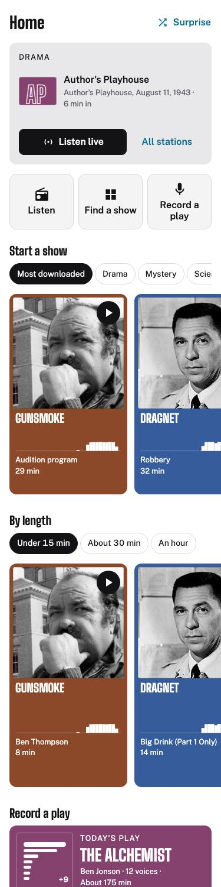
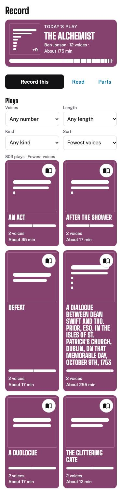
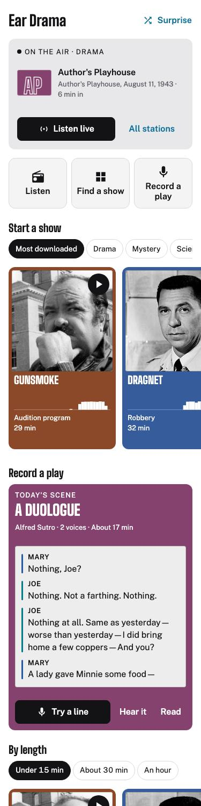
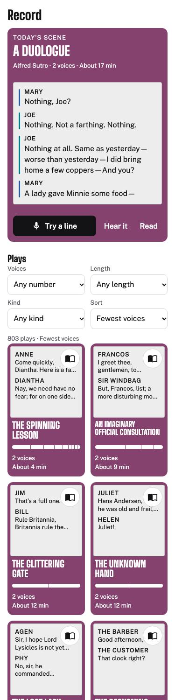
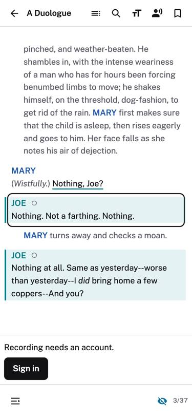

# R2: Design review of the first run (Home, Record, the way into the studio), 2026-11-15

The owner, 2026-11-14: *"The home page needs significant work. It is entirely unclear what the app
is or how to use it easily. The actions within the app need to get much easier to undersand and
follow. Right now, it just shows as a database of old content."* and *"I would like for people to
get excited about recording new Ear Dramas and the perusal of public domain plays and radio dramas
should be available and easy to access. We need to design for this (with design patter research)
rather than just bolt this functionality on."* On 2026-11-15 they asked that the loop keep
"building features and improving the design of the app."

Since then: Decision 075 (Home · Browse · Record · Search · Library; Home leads with On the air),
the Record tab, the reader, the studio inside it, voice casting and marks. This review asks whether
a newcomer now meets the owner's bar, fixes what the web can fix inside Decision 075, and asks the
owner about the rest. Lenses: `learning-orientation-design`, `catalog-experience-design`,
`learner-experience-design`, `mobile-first-density-design`, `make-it-look-like-itself`,
`frontend-design`, and Concept B's intent in `R2-home-and-create.md` ("Listen live, find, record").

Frames: `tools/web_fit_home.py --shots` (headless Chrome, muted, never presses Play) at 320, 375,
390, 430 and 1440 px, light and dark, evening and day, Home with and without history, and Record:
30 frames before (against the live site) and 30 after (against a local copy of the live data whose
play index carries `opening` for the first 180 plays, `build/review/`). The studio from Try a line:
`build/review/try_line.py` (375 light, 1440 dark). Devices: the iPad's Home and Record frames from
`build/qa/ios-2026-11-14` (the newest on a device; the Pixel's newest frames are from 2026-11-04,
before Decision 075, so they are not judged here). Five frames are kept in `img/r2-review/`.
I read every frame named here.

---

## 1. What a newcomer sees (before, 2026-11-15, live site)

 

| # | Question | Answer before | Frame |
|---|---|---|---|
| F1 | What is this app, in three seconds? | The page title says **Home**. At 375 px nothing on the first screen names the app; "Ear Drama" appears only in the 1440 px sidebar. The On the air block's kicker is a bare **DRAMA** (a station name a newcomer cannot read as one) over a 64 px monogram. | home-evening-light-375, -dark-1440 |
| F2 | Is there one obvious first action? | Yes for listening: **Listen live** is the only ink button on the first screen. Decision 075 fixed the 2026-11-14 failure (no Play on Home). | home-evening-light-375 |
| F3 | Does Record look exciting, or like a list? | Like a list. Record opens on **Today's play**: on the review day *The Alchemist*, Ben Jonson, **12 voices, about 175 min**: the least possible invitation for a first try. Below it, 803 tiles that are all the same plum square of white bars. | record-light-375, -dark-1440 |
| F4 | Can a newcomer see Record from Home? | The door says **Record a play**, but the row itself sits below two rails of listening, roughly the third screen at 375 px. | home-evening-light-375 |
| F5 | Does anything show what an ear drama *is* (words spoken by voices)? | No. No word of any play is on Home or Record. Finished ear dramas ("Made here") are absent: none are published. The play board shows bars, never lines. | all |
| F6 | Do play tiles invite? | No. The window draws one bar per speaking part: a two-voice play is two white bars on plum. Nothing says these are scripts you could read aloud. Long Gutenberg titles fill the whole tile ("A DIALOGUE BETWEEN DEAN SWIFT AND THO. PRIOR, ESQ. IN THE ISLES OF ST. PATRICK'S CHURCH, DUBLIN, ON THAT MEMORABLE DAY, OCTOBER 9TH, 1753", 18 lines at 1440). | record-dark-1440 |
| F7 | Is the default order honest and useful? | "Fewest voices" ties broke by name, so the fourth tile at 375 px is a **255-minute** dialogue for two between twelve- and seventeen-minute plays. | record-light-375 |
| F8 | Do Home's rows repeat? | **By length · Under 15 min** opens on Gunsmoke, Dragnet, Johnny Dollar, Suspense, the same four shows (in the same order) as **Start a show · Most downloaded** right above it. Two adjacent rails read as one. | home-evening-dark-1440 |
| F9 | Can you try recording in the time it takes to get curious? | No. The fastest path was Record, Today's play, Record this, the cast sheet, a part, the studio: five steps, and then **"Recording needs an account."** with Sign in (owner rule 2026-10-23, PLAYS-DESIGN §2). | studio-from-try-375-light |
| F11 | Does the studio say one thing? | Signed out, it shows a red **Record** button in the side panel and, under the page, "Recording needs an account." with Sign in: two contradicting signals on one screen. | studio-from-try-1440-dark |
| F10 | Do unfinished productions pile up? | On the iPad, Record's Yours lists **"After Taps · 0 of 594 lines recorded" twice**: two productions with nothing in them. An abandoned try becomes clutter at the top of the tab. | ios-2026-11-14/record shot-0000 |

What already works, and stays: On the air with Listen live (F2); the three doors; the chip rows;
This day in radio as a lower row; the play page and the reader; the studio's cue underline on the
line before yours (the after frame shows it on JOE's first line).

## 2. Research: what makes creation feel exciting where most people consume

1. **Most people will not create, and design moves the ratio.** Nielsen's participation-inequality
   rule (about 90% lurk, 9% contribute a little, 1% do most of it) comes with his prescription:
   you cannot remove the inequality, but you can make contributing easier, let people edit rather
   than create from nothing, and make participation a side effect of what they already do
   ([Nielsen, 2006, reposted](https://churbuck.com/2006/10/31/participation-inequality-lurkers-vs-contributors-in-internet-communities-jakob-nielsens-alertbox/);
   [the rule's history](https://thinkinsights.net/strategy/1-rule)). For Ear Drama: a ready
   scene with the other part already read is "edit, don't create".
2. **Begin with a duet, not a solo.** Smule's store page tells new users to start by joining duets
   ([App Store](https://apps.apple.com/app/id509993510)). A case study of its Sing! app found many
   people began taking part in the community after their first collaboration, and that partner-artist
   recordings motivate a first duet because you sing *with* someone
   ([UX Collective](https://uxdesign.cc/how-to-design-an-experience-for-the-global-community-by-leveraging-machine-learning-648ed214a35c)).
   The same study found that showing a newcomer many versions of one song can backfire. In 2021
   Smule added **Moments**, singing just a short section, to make it easier for casual users
   ([Wikipedia](https://www.wikipedia.com/wiki/Smule_(app))). For Ear Drama: one scene for two,
   one line first, the cast's voice as your partner.
3. **The first success comes before the commitment.** Duolingo runs a first exercise before asking
   anyone to sign up, and asks for an account to *save* progress after the first lesson
   ([Appcues GoodUX](https://goodux.appcues.com/blog/duolingo-user-onboarding);
   [Taplytics on the delayed sign-up test](https://taplytics.com/blog/duolingo-ab-test-onboarding)).
   Ear Drama asks for an account before the first take (F9). That rule is the owner's; see Q1.
4. **Show the thing itself, from the source.** `R2-home-and-create.md` §2 already established that
   creation stays visible when the verb sits on the thing being consumed (TikTok's "Use this
   sound", BandLab forks, LibriVox's open casts). The cheapest honest sample of "what an ear drama
   sounds like" is the opening of a real play, on screen in its own words, read aloud by the
   voices that will be your scene partners. It needs no finished drama to exist and invents no copy.

## 3. What was built (web), inside Decision 075

 

1. **Today's scene replaces Today's play** on Home and Record (F3, F5, F9). `PlaysCore.todaysScene`
   is `todaysPlay`'s hash over a pool: two voices and at most 20 minutes (14 plays today), else two
   or three voices and at most 30, else every play. The card: the title block on the drama board
   (author, "2 voices", "About 17 min"), then **the opening as a page**: the first four speeches,
   each its role over its said words, a rule in the part's hue. Then **Try a line** (ink, mic),
   **Hear it**, **Read**.
   - **Try a line** begins (or reuses) this browser's production of the play for the voice that
     answers (the second speaker) and opens the studio on that part's first line. Pressed in
     headless Chrome: `?read=gut-14519-3&production=…&part=role:JOE&line=L0006`, JOE's line framed,
     MARY's cue underlined. Two steps, down from five.
   - **Hear it** reads the opening aloud, live, in the cast's device voices (the play's one cast,
     `CastUI.castFor`), lights the speech being read and becomes Stop; it pauses the player, stops
     on any route change and keeps nothing (Decision 055: a synthetic voice is a live stand-in).
     Pressed muted: one speech lit, "Stop", then back to "Hear it" with none lit. Not heard aloud.
2. **Record a play moved up** to Home's second row, between Start a show and By length (F4, F8): it
   is on the second screen at 375 px and it parts the two rails that open on the same shows.
3. **Play tiles show the play's opening** (F6). The library index gains `opening` (the first two
   speeches, `{role, text}`, cut near 90 characters at a word, double hyphens as dashes, a stray
   leading stop dropped; `catalog/tools/build_play_library.py` `opening_of`, tested). A tile whose
   row has it draws a page in the window; a row without it keeps the cast bars. **The published
   index does not have it yet**: it arrives with the next `bash tools/refresh_play_library.sh`
   (harvest, build, tests, a dated Release asset), which this review did not run.
4. **Long titles stop at four lines** on a tile (F6); the play page carries the whole. A tile's
   role names sit on their own line and end in an ellipsis rather than breaking inside the name
   (the first draft broke MURASHK|IN and SAMANTH|A at 320 px; the fit gate now checks the said lines,
   and the names cannot wrap).
5. **Fewest voices breaks ties shortest first** (F7).
6. **Home is titled Ear Drama**, and On the air's kicker reads "● On the air · Drama" (F1). The dot
   is ink: red stays recording only (Decision 064).

Unchanged: Decision 075's five sections, the doors, the rows and their data rules. No sentence
explains the app; the only new words are labels (Today's scene, Try a line, Hear it, Stop, On the
air) and the plays' own lines.

### Verification

- `node js/*.test.js`: every suite passes (plays 309, including `todaysScene` and `openingOf`).
- `bash tools/test_web.sh`: PASS, 22 suites. `python3 tools/test_us_english.py`: PASS.
  `node tools/test_design_tokens.mjs`: all 14 token files match; contrast holds.
- `catalog/tests/test_play_library.py`: 27/27, with the new `opening` case.
- `tools/web_fit_home.py --data <overlay>`: **PASS, 0 problems, 30 frames** (final run). It now also fails when
  Record draws no play tiles of either kind, when Home or Record lacks the scene card and its
  opening, or when an opening line runs out sideways. It caught the scene's buttons wrapping at
  320 px (`.actions` re-allowed wrapping after `.actions-one`), fixed with `flex-wrap: nowrap` on
  `.pl-scene-actions`; that is its second negative control.
- Service worker shell `ed-shell-v70`.

## 4. Still failing (not fixed here)

- **F9, the account wall.** Try a line lands in the studio, and the studio says "Recording needs an
  account." for anyone signed out. The first take costs a sign-in. Owner question Q1.
- **F10, empty productions.** A production with no takes stays in Yours forever. Try a line reuses
  the play's production, so it adds at most one per play, but a newcomer who tries three scenes
  has three empty rows. Q2.
- **F5, a finished drama.** "Made here" is empty until someone publishes. Hear it is the honest
  stand-in; a real finished ear drama on Home is the stronger proof. Q3.
- **F8 at the source.** The `byLength` shelf and the `mostDownloaded` shelf draw from the same
  series. Separating the rows on screen is a patch; the shelf rule (contract §5.1) could skip
  series already on Most downloaded. A catalog change for a later round.
- **F11, two signals in the studio.** The side panel's Record and the account line contradict
  each other for a signed-out person; whichever way Q1 goes, the studio should say one thing.
- **F1, the monogram.** On the air shows a 64 px monogram for most shows (1,059 of 1,311 are
  typographic). A larger window would not help a typographic one; left as is.

## 5. Owner questions

**Q1. Can a newcomer record a first take without an account?** (PLAYS-DESIGN §2: "Recording needs
an account, always", owner 2026-10-23.)
- **A (recommended)**: Try a line records signed out. Takes stay on this device (as they already do
  for everyone in phase 1); an account is asked for when the person shares, or before a second
  play. Research §2.3: the first success before the commitment.
- B: signed out, Try a line records one line only, kept until the page closes; Sign in to keep it.
- C: keep the rule; Try a line shows "Recording needs an account." with Sign in, as now.

Before: `img/r2-review/before-record-375.jpg`. After, signed out today:
`build/review/after/studio-from-try-375-light.png` (the studio on JOE's line, the account
wall under it).

**Q2. What happens to a production with no takes?**
- **A (recommended)**: it is not listed in Yours until its first take, and it is removed with the
  next visit if it has none; Try a line keeps reusing it meanwhile.
- B: it is listed, as now (the iPad shows "After Taps · 0 of 594" twice).

**Q3. When the first ear drama is published, should Home show it above Start a show?**
- **A (recommended)**: yes, one card ("Made here", the newest finished drama, Play on it) directly
  under the doors while there are fewer than six, then the row as now.
- B: keep Made here as the last row.

**Q4. Today's scene on every platform?** The web now shows Today's scene where Today's play was;
the Apple and Android apps still show Today's play, so the web and the apps show different plays
until they are ported.
- **A (recommended)**: port Today's scene everywhere (brief below); retire Today's play.
- B: keep Today's play on the apps, Today's scene on the web.

## 6. Port brief (Apple iOS / iPad / Mac, Android; not TVs)

Binding text: WEB-DESIGN §4.2 items 1, 2 and 7, §4.15 items 2 and 3; contract §4.1 `opening`;
pending-port notes in `iOS-DESIGN.md`, `ANDROID-DESIGN.md`, `macOS-DESIGN.md`.

1. **Core**: `todaysScene(rows, date)` = `todaysPlay(scenePool(rows), date)`; `scenePool` is the
   first non-empty of (voices == 2, minutes ≤ 20), (2 ≤ voices ≤ 3, minutes ≤ 30), all. Unit-test
   the pool as `js/plays.test.js` does; the existing goldens cover the hash.
   `openingOf(script, n)`: the first n speeches with said words, as `{part, name, text, lineID}`,
   underscores dropped, whitespace collapsed, a leading `.,:;—-` dropped, `--` as an em dash; from
   the index row's `opening` when there are no lines.
2. **Card**: the drama board; kicker "Today's Scene" (iOS title case) / "Today's scene"; title;
   author · N voices · About M min; the opening as a page on the print ground (role name, caption
   strong; said words, three lines at most; a 3 pt rule in `partHue`); one row of **Try a Line**
   (borderedProminent / filled, mic), **Hear It** (bordered / text button, hidden with no voice),
   **Read**. The row never wraps at the smallest width.
3. **Try a Line**: the reader's Record path (`Studio.begin` equivalent) for the second speaker of the
   opening, else the second part; open the studio on that part's first line.
4. **Hear It**: read the opening with the device voices through the play's one cast
   (`VoiceCast`/`AVSpeechSynthesizer` / `TextToSpeech`), lighting the current speech; Stop; pause
   the player first; stop on navigation; keep nothing.
5. **Home order**: Record a Play between Start a Show and By Length. Title "Ear Drama"; On the air
   kicker "On the air · {source}" after an ink dot.
6. **Play tiles**: when the row has `opening`, the window is a page (role strong, words, three lines
   each); else the cast bars. Titles stop at four lines. Fewest voices ties shortest first.
7. **Verify** on the iPhone 12, the iPad, a Mac window and the Pixel 8a: Home's first two screens,
   Record's top, Try a Line pressed (the studio on the right line), Hear It pressed muted.

## 7. Frames read (after)

`build/review/after/` (not committed; regenerate with `python3 build/review/augment.py`, a data
proxy `build/review/proxy.py PORT`, then `tools/web_fit_home.py --shots DIR --data http://127.0.0.1:PORT/`
and `build/review/try_line.py`): read one by one at record 320 light and dark, record 375 light,
record 1440 dark, home-evening 320 light, 375 dark and 1440 light, home-day-history 430 dark, and
the studio from Try a line at 375 light and 1440 dark; the other 375/390/430 frames read on one
contact sheet. With history, Continue pushes the scene card below the first screen at 375 px, as
the rule intends (Continue is the one personal row). The 320 px frames showed the mic icon shrinking
inside Try a line; fixed (`flex: none` on the icon) after the final run, not re-shot.

